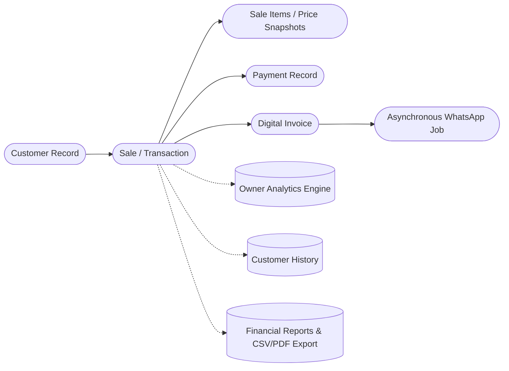

# Trimz Salon — Operations & Business Management Platform

> **Source of Truth Documentation Hub**  
> *The operational core, technical architecture, and implementation blueprint for Trimz Salon.*

---

## 1. Executive Summary & Product Vision

**Trimz Salon** is an integrated **Salon Operations & Business Management Platform**. It unites two essential interfaces into a single, high-reliability system:
1. **Public Brand Showcase:** A modern, mobile-first web storefront for clients to discover services, transparent pricing, business hours, and location.
2. **Operations & Business Management Dashboard:** A high-efficiency point-of-sale (POS) and managerial portal enabling salon operators to perform walk-in checkout in seconds, record split/digital payments, generate deterministic tax invoices, asynchronously deliver bills via the official Meta WhatsApp Cloud API, and monitor real-time business analytics and financial reports.

### 1.1 Core Business Objective
> *"Reduce the owner's manual work and friction while giving the owner complete visibility and control over the salon's business operations."*

We adhere to a strict **smallest strong operational core** philosophy:
- We do **not** build an over-engineered enterprise ERP.
- We do **not** build separate manual databases for daily/weekly/monthly revenue—**the transactional database is the single source of truth**.
- Every single feature must demonstrably save time, eliminate human error, improve customer retention, or provide actionable visibility into salon operations.

---

## 2. Canonical System Architecture

$$\textbf{Next.js / React Frontend} \longrightarrow \textbf{FastAPI Backend (Python)} \longrightarrow \textbf{PostgreSQL 16 Database}$$
$$\text{FastAPI} \longrightarrow \textbf{Redis} \longrightarrow \textbf{Python Background Worker} \longrightarrow \textbf{Meta WhatsApp Cloud API}$$

- **Frontend:** Next.js (TypeScript, Tailwind CSS) for both the Public Showcase and the Owner/Operator Dashboard.
- **Backend:** **FastAPI (Python 3.11+)** as the primary, authoritative business and application backend owning validation, calculations, transactions, reporting, and webhook processing.
- **Database:** **PostgreSQL 16** providing strict ACID guarantees.
- **Worker & Queue:** **Redis + Python Background Worker** (ARQ/RQ) for non-blocking PDF rendering and Meta WhatsApp Cloud API dispatch.
- **AI / Machine Learning:** TensorFlow is **not** in the MVP scope.
- **Real-Time Communication:** WebSockets are **not** mandatory for the MVP; standard REST endpoints handle data operations.

---

## 3. The Core Transactional Spine

At the heart of Trimz Salon lies an immutable, unified transactional chain:

### 3.1 Failure Isolation Guarantee
> **A failure in external WhatsApp delivery must NEVER invalidate or roll back a completed financial sale or invoice.**

If WhatsApp dispatch fails, the sale, payment, and invoice remain completely valid. The failed message is flagged for retry without disrupting the salon's financial records.

---

## 4. Master Documentation Index

All architectural guidelines, software requirements, database definitions, API contracts, and implementation roadmaps are formally specified in the `/docs` directory:

| Document | Title | Purpose |
| :--- | :--- | :--- |
| **[01-PRD](file:///c:/Users/sai%20pallavi/OneDrive/Desktop/trimz/docs/01-product-requirements-document.md)** | Product Requirements Document | Complete functional requirements, business objectives, role-based personas, MVP scope, and scope control framework. |
| **[02-SRS](file:///c:/Users/sai%20pallavi/OneDrive/Desktop/trimz/docs/02-software-requirements-specification.md)** | Software Requirements Specification | Formal requirements with IDs, acceptance criteria, NFRs, and end-to-end traceability matrix. |
| **[03-Architecture](file:///c:/Users/sai%20pallavi/OneDrive/Desktop/trimz/docs/03-system-architecture.md)** | System Architecture & Technical Design | Multi-tier architecture, FastAPI backend, Redis/Python worker, Meta Cloud API pipeline, and failure isolation. |
| **[04-Data Models](file:///c:/Users/sai%20pallavi/OneDrive/Desktop/trimz/docs/04-database-schema-and-domain-models.md)** | Database Schema & Domain Models | PostgreSQL 16 DDL, ER diagram, decoupled state enums, historical price snapshots, and customer cache reconciliation. |
| **[05-API Specs](file:///c:/Users/sai%20pallavi/OneDrive/Desktop/trimz/docs/05-api-and-integration-specifications.md)** | API & Integration Specifications | RESTful contracts, Pydantic models, Meta WhatsApp Cloud API payloads, HMAC SHA-256 webhook security, and CSV/PDF export. |
| **[06-Roadmap](file:///c:/Users/sai%20pallavi/OneDrive/Desktop/trimz/docs/06-implementation-roadmap-and-development-guide.md)** | Implementation Roadmap & Guide | Phased roadmap (Phases 0–9), scope control rules, mandatory critical testing scenarios, and `.env.example` template. |
| **[07-Memory](file:///c:/Users/sai%20pallavi/OneDrive/Desktop/trimz/docs/07-memory.md)** | Project Implementation Memory | Verified execution log with zero fabricated history. |
| **[Feature Inventory](file:///c:/Users/sai%20pallavi/OneDrive/Desktop/trimz/docs/reference-feature-inventory.md)** | Prototype Feature Inventory | Complete audit and reconciliation of `trimz-salon-desk-no-login.html`. |

---

## 5. Scope Boundaries

### Inside MVP Scope
- Public storefront website (services, prices, hours, location).
- Operator walk-in POS checkout interface (< 400ms target).
- Customer phone lookup and duplicate prevention.
- Multi-service selection with historical price snapshots.
- Payment recording (Cash, UPI with Google Pay/PhonePe/Paytm breakdown, Card).
- Sequential invoice generation (printable view and PDF document).
- Asynchronous WhatsApp Cloud API invoice dispatch with webhook status tracking.
- Owner analytics dashboard with dynamic date filters (Today, Yesterday, Week, Month, Custom, Lifetime).
- Parametric reporting with streaming CSV and formatted PDF exports.

### Outside MVP Scope (Future Phases)
- Online customer appointment booking & calendar reservations.
- Stylist commission tracking and staff payout calculation.
- Consumables and product retail inventory management.
- Customer loyalty programs, prepaid wallets, and memberships.
- Multi-branch centralized franchise management.
- Exploratory AI/ML demand forecasting.

---

## 6. Implementation Status

> **APPLICATION IMPLEMENTATION HAS NOT STARTED.**  
> The repository is in the finalized documentation and architectural baseline phase.

---
*Maintained by the Lead Software & Product Architecture Team for Trimz Salon.*
