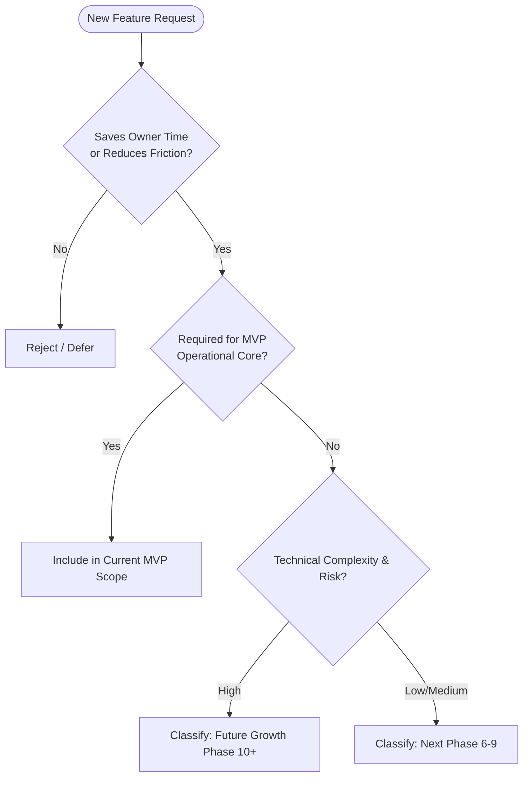

# Product Requirements Document (PRD) — Trimz Salon

| Document Metadata | Details |
| :--- | :--- |
| **Product Name** | Trimz Salon |
| **Document Version** | 2.0.0 (Canonical Reconciled Specification) |
| **Document Status** | Approved Canonical Baseline |
| **Author** | Lead Software Architect & Product Architect |
| **Target Audience** | Engineering Team, System Architects, Salon Stakeholders |

---

## 1. Product Vision & Strategic Intent

**Trimz Salon** is a comprehensive **Salon Operations & Business Management Platform**.

The platform is explicitly **not** merely a salon marketing website. It is an end-to-end operational engine uniting two interfaces:
1. **Public Brand Showcase:** A fast, mobile-friendly storefront for clients to discover services, transparent pricing, operating hours, and location.
2. **Operations & Business Management Dashboard:** A high-efficiency point-of-sale (POS) and managerial portal enabling salon operators to perform walk-in checkout in seconds, record split/digital payments, generate deterministic tax invoices, asynchronously deliver bills via the official Meta WhatsApp Cloud API, and monitor business analytics and financial reports.

### 1.1 Core Business Objective
> *"Reduce the owner's manual work and friction while giving the owner complete visibility and control over the salon's business operations."*

Every technical feature and design choice must be evaluated against these strict criteria:
- **Saves Owner Time:** Eliminates manual register tallying and end-of-day spreadsheet reconciliation.
- **Reduces Operational Friction:** Enables rapid walk-in checkout without requiring customer app installations or OTP delays.
- **Eliminates Human Error:** Prevents cash/UPI discrepancies, double-billing, and customer duplication.
- **Improves Business Visibility:** Delivers real-time clarity on revenue, payment methods, digital providers, and service popularity.
- **Improves Customer Retention:** Creates a non-intrusive, polite digital touchpoint via WhatsApp invoice delivery.
- **Enables Future Growth:** Employs a modular foundation capable of adopting online booking, commissions, and multi-branch management without core rewrites.

---

## 2. Target Personas (Role-Based)

To maintain objective requirements without fabricated personal identities, the platform is designed around three canonical roles:

| Role Persona | Primary Responsibilities | Core Motivations | Key Operational Needs |
| :--- | :--- | :--- | :--- |
| **Salon Owner** | Executive oversight, financial audits, catalog governance, reporting. | Complete financial clarity, zero cash leakage, insights into top-performing services, automated compliance. | Real-time analytics dashboard, payment provider breakdowns, one-click PDF/CSV export for accounting. |
| **Salon Operator / Receptionist** | Front-desk reception, customer intake, service selection, checkout. | Fast, stress-free checkout that keeps customer queues moving quickly. | Phone-number autocomplete, rapid multi-service selection, instant receipt generation, failure-isolated WhatsApp delivery. |
| **Customer** | Salon client receiving treatments and grooming services. | Quick payment and transparent, itemized billing. | Instant digital receipt delivered to WhatsApp without spam or app downloads. |

---

## 3. Authoritative MVP Core Requirements

The MVP is bounded strictly by three core business requirements.

---

### Requirement 1: Salon Business Dashboard & Analytics

The dashboard provides the salon owner with instant operational and financial visibility, answering:
1. *"How is my business performing?"* (Macro KPIs: Gross revenue, volume, average bill value).
2. *"Why is it performing that way?"* (Micro breakdowns: Payment rails, service ranking, customer retention).

#### 1.1 Core Metrics & Transactional Derivation Rules
**Architectural Rule:** The transactional database is the sole source of truth. Analytics must be computed dynamically or derived from underlying completed sales and payments—never from independently maintained manual counters.

- **Gross Revenue:** Total sum of successful payments associated with completed sales.
- **Total Transactions:** Count of completed sales.
- **Average Bill Value (ABV):** Gross Revenue divided by Total Transactions.
- **Unique Customers Served:** Count of distinct customers with completed sales during the timeframe.
- **New Customers:** Count of customers whose initial sale was created within the timeframe.
- **Returning Customers:** Count of distinct customers with a completed sale in the timeframe who had prior transactions.
- **Payment Breakdown by Method:** Total volume and value grouped by `CASH`, `UPI`, `CARD`, and `OTHER`.
- **UPI Digital Provider Breakdown:** When payment method is `UPI`, secondary breakdown by provider (`Google Pay`, `PhonePe`, `Paytm`, `Other UPI`).
- **Service-Wise Revenue:** Total revenue generated grouped by service catalog item.
- **Top Services:** Services ranked by units sold and gross contribution.
- **Revenue Trends:** Chronological aggregation (daily, weekly, monthly buckets).

#### 1.2 Time Horizon Filtering
The dashboard must provide one-click temporal filtering across:
- **Today** (00:00:00 to current timestamp in configured salon timezone).
- **Yesterday** (Full 24-hour window of preceding date).
- **This Week** (Monday 00:00:00 to current timestamp).
- **This Month** (1st day of current month to current timestamp).
- **Last Month** (1st to final calendar day of preceding month).
- **This Year** (January 1st to current timestamp).
- **Custom Date Range** (User-defined start and end dates).
- **Lifetime** (Entire salon operational history).

---

### Requirement 2: Integrated Billing, Payment, Invoice & WhatsApp Workflow

This constitutes the end-to-end operational spine of the salon:
$$\text{Customer} \longrightarrow \text{Lookup/Create} \longrightarrow \text{Services} \longrightarrow \text{Bill Calculation} \longrightarrow \text{Payment} \longrightarrow \text{Sale} \longrightarrow \text{Invoice} \longrightarrow \text{WhatsApp} \longrightarrow \text{Status}$$

#### 2.1 Customer Resolution & Registration
- **Lookup:** Cashier inputs customer phone number (indexed lookup on normalized E.164 string).
- **Match:** Automatically retrieves name, previous visit count, and last visit timestamp.
- **New Customer:** Prompts for Customer Name (Required). Email is optional.

#### 2.2 Service Selection & Dynamic Cart Math
- Operator selects multiple catalog services with optional quantity adjustments.
- Line items snapshot unit price, quantity, and line discount.
- Cart computes:
  $$\text{Subtotal} = \sum (\text{Unit Price} \times \text{Quantity} - \text{Line Discount})$$
  $$\text{Tax Amount} = \text{Subtotal} \times \frac{\text{Configured Tax Rate}}{100}$$
  $$\text{Grand Total} = \text{Subtotal} - \text{Overall Discount} + \text{Tax Amount}$$

#### 2.3 Payment Handling
- Supports normalized methods: `CASH`, `UPI`, `CARD`, `OTHER`.
- For `UPI`, captures optional provider: `Google Pay`, `PhonePe`, `Paytm`, `Other`.
- Decouples method from provider for standardized accounting queries.

#### 2.4 Invoice Generation & Document Artifact
- Generates sequential invoice identifier (`TRIMZ-YYYYMM-XXXX`).
- Invoice data is stored as structured relational records.
- Document artifacts (PDF/print format) are generated on demand or stored as linked assets.

#### 2.5 Asynchronous WhatsApp Cloud API Delivery & Failure Isolation
- **Non-Blocking Execution:** Transaction completion must never block on WhatsApp network calls. The sale commits immediately, and WhatsApp dispatch is handed to a background queue.
- **Failure Isolation:** A failure in WhatsApp delivery does not roll back or invalidate the completed financial transaction.
- **Official Meta Cloud API:** Only official Meta WhatsApp Business Cloud API templates are used. No web scraping or unofficial browser automation.
- **Lifecycle Tracking:** Webhooks update message delivery status: `QUEUED` $\rightarrow$ `SENDING` $\rightarrow$ `SENT` $\rightarrow$ `DELIVERED` $\rightarrow$ `READ` (or `FAILED` with retry capability).

---

### Requirement 3: Business Reports & Multi-Format Data Export

The reporting system provides formal audits and data extraction derived directly from the transactional engine.

#### 3.1 Report Types
- **Sales Report:** Itemized transaction ledger (invoice number, date, customer, services, subtotal, tax, discount, total).
- **Payment Collection Report:** Cash, UPI, provider distribution, and reconciliation totals.
- **Customer Activity Report:** Customer visits, spend distribution, and retention indicators.
- **Service Performance Report:** Units sold, revenue per service, and category performance.
- **Complete Business Summary:** High-level executive overview for accountants and tax advisors.

#### 3.2 Export Formats
- **PDF Export:** Formatted, branded document suitable for sharing, archiving, and printing.
- **CSV / Excel Compatible Export:** Raw structured tabular output for ingestion into Excel, Google Sheets, or accounting software.

---

## 4. Scope Control Framework & Future Feature Roadmap

To prevent scope creep, every proposed feature must be evaluated through the following decision matrix:

### 4.1 Feature Classification Matrix

| Feature | Classification | Rationale & Dependencies |
| :--- | :--- | :--- |
| **Walk-in POS Checkout & Invoicing** | **MVP Core** | Essential for daily salon operations. |
| **Official WhatsApp Cloud API Delivery** | **MVP Core** | Core customer communication channel. |
| **Owner Analytics Dashboard** | **MVP Core** | Delivers business visibility and control. |
| **PDF & CSV Reporting** | **MVP Core** | Required for daily close and tax accounting. |
| **Public Showcase Website** | **MVP Core** | Provides digital presence and service catalog. |
| **Online Appointment & Slot Booking** | *Phase 2 (Post-MVP)* | Requires calendar locking and customer notification flows; depends on core catalog. |
| **Stylist Commission Tracking** | *Phase 2 (Post-MVP)* | Requires staff association with line items and payout calculation logic. |
| **Inventory & Product Retail Stock** | *Phase 3 (Post-MVP)* | Requires stock deduction triggers upon service completion. |
| **Customer Loyalty & Prepaid Packages** | *Phase 3 (Post-MVP)* | Requires wallet balance ledger and expiration logic. |
| **Multi-Branch Operations** | *Phase 4 (Post-MVP)* | Foundation enabled by `business_id` scoping; centralized UI deferred. |
| **AI / Machine Learning (Forecasting/Churn)** | *Future Exploratory* | Requires large historical datasets; zero utility during initial launch. |

---

## 5. Non-Functional Requirements (NFRs)

- **POS Checkout Latency:** Fast transaction commit and UI reset in under 400ms.
- **Idempotency:** Prevent duplicate billing through unique request tokens.
- **Immutability:** Snapshotted service prices in line items guarantee historical financial accuracy.
- **Configurable Business & Tax Profile:** Configurable tax rates, tax numbers, currency, and timezones—no hardcoded regional tax assumptions.
- **Role-Based Security:** Strict separation between Owner (full access) and Operator (POS checkout and customer view only).

---
*End of Product Requirements Document.*
