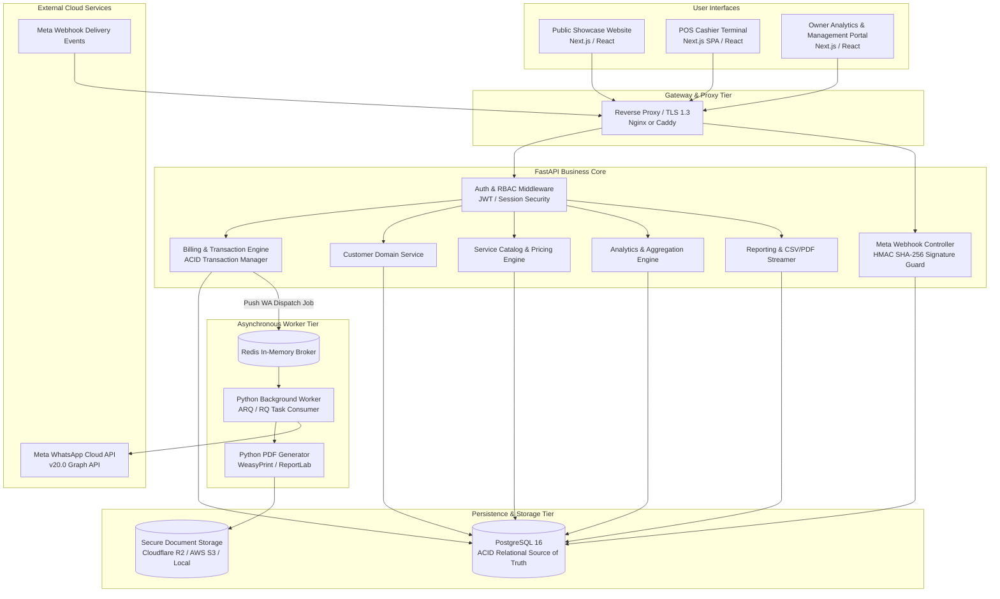
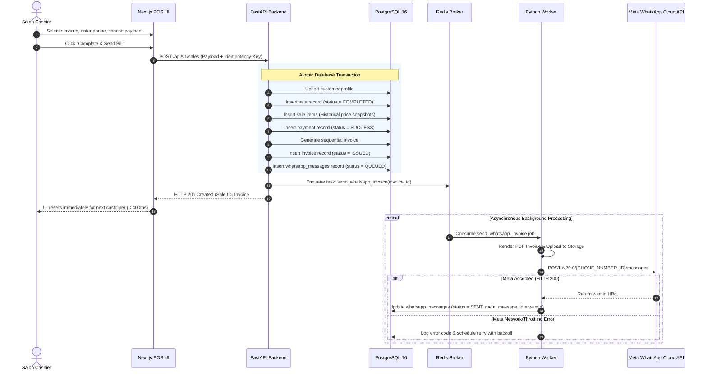

# System Architecture & Technical Design — Trimz Salon

| Document Metadata | Details |
| :--- | :--- |
| **Document Version** | 2.0.0 (Canonical Architecture Blueprint) |
| **Status** | Approved System Architecture Specification |
| **Primary Core** | Next.js Frontend + FastAPI Backend + PostgreSQL + Redis/Python Worker |
| **Author** | Lead Software Architect & Systems Engineering Team |

---

## 1. High-Level Architectural Pattern

The canonical architecture for **Trimz Salon** is a **Modern Multi-Tier Decoupled Architecture**:

$$\textbf{Next.js / React Frontend} \longrightarrow \textbf{FastAPI Backend (Python)} \longrightarrow \textbf{PostgreSQL 16 Database}$$
$$\text{FastAPI} \longrightarrow \textbf{Redis} \longrightarrow \textbf{Python Background Worker} \longrightarrow \textbf{Meta WhatsApp Cloud API}$$

---

## 2. Technology Stack & Component Responsibilities

### 2.1 Backend Core: FastAPI (Python 3.11+)
FastAPI serves as the **exclusive, authoritative application and business backend**.
- **Responsibilities:**
  - Owns all business rules, calculations, tax computations, and data validation (Pydantic v2).
  - Enforces role-based authorization (`OWNER` vs `OPERATOR`).
  - Orchestrates ACID database transactions and idempotency checks.
  - Computes all analytical aggregations directly from the transactional database.
  - Ingests and cryptographically validates incoming Meta WhatsApp webhooks.
  - Serves streaming data exports (CSV and PDF).
- **Architectural Rule:** The frontend is purely a presentation layer; it is never the source of truth for business logic.

### 2.2 Frontend Core: Next.js / React (TypeScript)
Next.js provides the public storefront and authenticated administrative interfaces.
- **Node.js Boundary Position:** Node.js exists strictly as part of the JavaScript ecosystem for Next.js and frontend build tooling. It does **not** serve as a second backend, and does not run Express or NestJS services.

### 2.3 Primary Database: PostgreSQL 16
PostgreSQL is the **authoritative, single source of truth** for all business facts.
- Fully normalized relational schema with strict foreign key constraints.
- Compound B-Tree indexes for sub-millisecond range lookups.
- ACID transaction boundaries ensure financial integrity.

### 2.4 Asynchronous Worker: Redis + Python Background Worker
- **Queue Broker:** Redis handles durable in-memory job queueing.
- **Worker Process:** A lightweight Python asynchronous worker (using ARQ or RQ) consumes tasks.
- **Responsibilities:** Renders PDF invoices, uploads artifacts to cloud storage, dispatches template messages to Meta WhatsApp Cloud API, and records initial transmission states.

### 2.5 Machine Learning & AI Position
- **TensorFlow / AI is NOT in MVP Scope.** There is no confirmed machine learning requirement for initial salon operations.
- Future post-MVP capabilities (such as demand forecasting, customer churn prediction, or revenue projections) are documented strictly as future exploratory enhancements.

### 2.6 Real-Time Communication Position
- **WebSockets are NOT mandatory for the MVP.**
- All core functions (Billing, Customer Search, Analytics, and Reports) communicate via standard HTTP/REST APIs.
- Dashboard metric updates and message delivery states use fast standard REST calls or client-side polling where needed. WebSockets/SSE will only be introduced if an approved real-time requirement emerges.

---

## 3. Transactional Spine & Execution Flow

The canonical operational spine connects:
$$\text{Customer} \longrightarrow \text{Sale} \longrightarrow \text{SaleItems} \longrightarrow \text{Payment} \longrightarrow \text{Invoice} \longrightarrow \text{WhatsAppMessage}$$

---

## 4. Failure Isolation & Financial Independence

An absolute architectural requirement is **failure isolation**:

> **A failure in external WhatsApp delivery must NEVER invalidate or roll back a completed financial sale or invoice.**

- If the customer's phone number is invalid, if Meta experiences downtime, or if carrier delivery fails:
  - `Sale` status remains `COMPLETED`.
  - `Payment` status remains `SUCCESS`.
  - `Invoice` status remains `ISSUED`.
  - `WhatsAppMessage` status transitions to `FAILED` with logged error details.
- The cashier or salon owner can inspect the failure in the dashboard and trigger a manual resend once the phone number or network issue is resolved.

---

## 5. Official Meta WhatsApp Cloud API Architecture

### 5.1 Outbound Message Dispatch
- Strictly uses the official Meta WhatsApp Business Cloud API (Graph API v20.0).
- All communications utilize pre-approved transactional utility templates (e.g. `trimz_invoice_notification`).
- Dynamic template parameters include: Customer Name, Invoice Number, Amount Paid, Salon Name, and a signed download link to the PDF invoice.

### 5.2 Inbound Webhook Security & Status Synchronization
Meta sends asynchronous delivery receipts (`sent`, `delivered`, `read`, `failed`) to `/api/webhooks/whatsapp`.

1. **Verification Challenge (`GET`):** Validates `hub.verify_token` against the configured application secret and returns `hub.challenge`.
2. **Signature Verification (`POST`):**
   - Every incoming request carries the header `X-Hub-Signature-256: sha256={hash}`.
   - FastAPI computes `HMAC_SHA256(raw_request_body, META_APP_SECRET)`.
   - Mismatched signatures are rejected with HTTP 403 Forbidden.
3. **Idempotent State Transition:**
   - Webhooks are processed idempotently using Meta's `wamid`.
   - Updates `whatsapp_messages.status` column and records timestamps (`delivered_at`, `read_at`).

---

## 6. Document Generation & Storage Architecture

1. **Structured Data as Primary Representation:** The invoice is first and foremost structured business data in PostgreSQL; the PDF document is a generated artifact.
2. **Engine:** Invoices are rendered server-side using Python PDF generators (e.g., WeasyPrint or ReportLab), ensuring crisp vector rendering and accurate page dimensions (standard 80mm thermal receipt format or A4/A5 tax invoice).
3. **Storage:** Generated PDFs are uploaded to S3-compatible cloud storage (e.g., Cloudflare R2 or AWS S3) with secure, expiring signed URLs.

---

## 7. Security, Authorization & Tenant Scoping

- **Role-Based Access Control (RBAC):**
  - `OWNER`: Full administrative access to dashboard analytics, financial reports, catalog pricing, and staff profiles.
  - `OPERATOR`: Access restricted to customer lookup, cart creation, payment recording, and receipt printing. Financial analytics and historical profit reports are hidden.
- **Tenant Isolation:** Every operational table includes `business_id` foreign keys, ensuring clean branch isolation from day one.
- **Zero Secrets in Code:** All database credentials, JWT secrets, and Meta API keys are supplied strictly via environment variables.

---
*End of System Architecture Document.*
