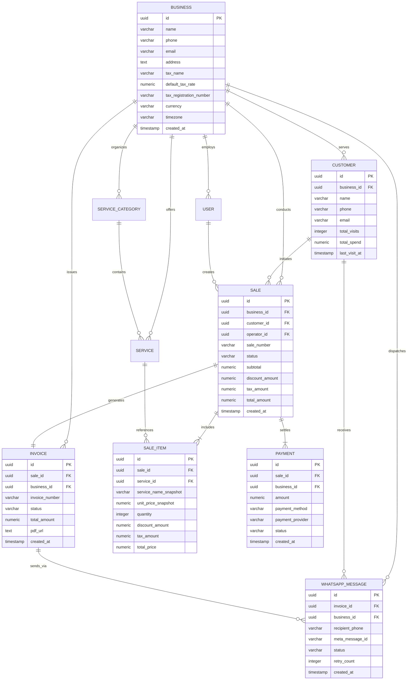

# Database Schema & Domain Models — Trimz Salon

| Document Metadata | Details |
| :--- | :--- |
| **Document Version** | 2.0.0 (Canonical Schema Specification) |
| **Database Engine** | PostgreSQL 16+ (ACID Compliant) |
| **Status** | Approved Baseline Relational Schema |
| **Author** | Lead Software Architect & Data Engineering Specialist |

---

## 1. Domain Modeling Principles

The database design for Trimz Salon is governed by five foundational rules:

1. **Transactional Spine as the Sole Source of Truth:**
   Financial facts exist exclusively in immutable ledger records: `sales`, `sale_items`, `payments`, and `invoices`. Dashboard analytics and reports are derived directly from this ledger.
2. **Mandatory Price & Item Snapshots:**
   Catalog prices can change over time. When a sale occurs, the service name and unit price are permanently snapshotted into `sale_items`. Historical records never change when catalog prices change.
3. **Decoupled Financial State Lifecycles:**
   Sale, Payment, Invoice, and WhatsApp message lifecycles are independent. A WhatsApp failure never invalidates an invoice; an invoice void never erases a payment record.
4. **Tenant Scoping from Day One:**
   All core operational tables include `business_id` foreign keys, enabling clean multi-branch expansion in the future without schema overhauls.
5. **Customer Cache Reconciliation:**
   Customer metric fields (`total_visits`, `total_spend`, `last_visit_at`) serve strictly as read-optimized caches for fast cashier lookups. They are kept up to date transactionally, and can be reconciled against the `sales` table at any time.

---

## 2. Entity-Relationship Diagram (ERD)



---

## 3. Enumerated Types & Value Domains

```sql
-- User and Authorization Roles
CREATE TYPE user_role AS ENUM ('OWNER', 'OPERATOR');

-- Transaction and Sale Lifecycle
CREATE TYPE sale_status AS ENUM (
    'DRAFT', 
    'COMPLETED', 
    'CANCELLED', 
    'REFUNDED'
);

-- Payment Settlement Status
CREATE TYPE payment_status AS ENUM (
    'PENDING', 
    'SUCCESS', 
    'FAILED', 
    'REFUNDED'
);

-- Payment Methods
CREATE TYPE payment_method_enum AS ENUM (
    'CASH', 
    'UPI', 
    'CARD', 
    'OTHER'
);

-- Legal Invoice Status
CREATE TYPE invoice_status AS ENUM (
    'ISSUED', 
    'VOID', 
    'REPLACED'
);

-- Meta WhatsApp Delivery Lifecycle
CREATE TYPE whatsapp_delivery_status AS ENUM (
    'QUEUED', 
    'SENDING', 
    'SENT', 
    'DELIVERED', 
    'READ', 
    'FAILED'
);
```

---

## 4. PostgreSQL DDL Specifications

### 4.1 Business & Configurable Profile
```sql
CREATE TABLE businesses (
    id UUID PRIMARY KEY DEFAULT gen_random_uuid(),
    name VARCHAR(150) NOT NULL,
    legal_name VARCHAR(200),
    phone VARCHAR(20) NOT NULL,
    email VARCHAR(100),
    address TEXT NOT NULL,
    city VARCHAR(100) NOT NULL,
    state VARCHAR(100) NOT NULL,
    postal_code VARCHAR(20) NOT NULL,
    country VARCHAR(10) NOT NULL DEFAULT 'IN',
    -- Configurable Tax Profile (No hardcoded tax assumptions)
    tax_name VARCHAR(50) DEFAULT 'GST',          -- E.g. 'GST', 'VAT', 'Sales Tax'
    default_tax_rate NUMERIC(5, 2) DEFAULT 0.00,  -- Percentage (e.g. 0.00, 5.00, 18.00)
    tax_registration_number VARCHAR(50),         -- E.g. GSTIN, VAT ID
    currency VARCHAR(5) NOT NULL DEFAULT 'INR',
    timezone VARCHAR(50) NOT NULL DEFAULT 'Asia/Kolkata',
    logo_url TEXT,
    is_active BOOLEAN NOT NULL DEFAULT TRUE,
    created_at TIMESTAMPTZ NOT NULL DEFAULT CURRENT_TIMESTAMP,
    updated_at TIMESTAMPTZ NOT NULL DEFAULT CURRENT_TIMESTAMP
);

CREATE INDEX idx_businesses_active ON businesses(is_active);
```

### 4.2 Users & Staff Operators
```sql
CREATE TABLE users (
    id UUID PRIMARY KEY DEFAULT gen_random_uuid(),
    business_id UUID NOT NULL REFERENCES businesses(id) ON DELETE RESTRICT,
    name VARCHAR(120) NOT NULL,
    phone VARCHAR(20) NOT NULL,
    email VARCHAR(120) NOT NULL,
    password_hash VARCHAR(255) NOT NULL,
    role user_role NOT NULL DEFAULT 'OPERATOR',
    is_active BOOLEAN NOT NULL DEFAULT TRUE,
    created_at TIMESTAMPTZ NOT NULL DEFAULT CURRENT_TIMESTAMP,
    updated_at TIMESTAMPTZ NOT NULL DEFAULT CURRENT_TIMESTAMP,
    CONSTRAINT uq_users_business_email UNIQUE (business_id, email),
    CONSTRAINT uq_users_business_phone UNIQUE (business_id, phone)
);

CREATE INDEX idx_users_business_role ON users(business_id, role);
```

### 4.3 Service Categories & Catalog Items
```sql
CREATE TABLE service_categories (
    id UUID PRIMARY KEY DEFAULT gen_random_uuid(),
    business_id UUID NOT NULL REFERENCES businesses(id) ON DELETE CASCADE,
    name VARCHAR(100) NOT NULL,
    description TEXT,
    display_order INT NOT NULL DEFAULT 0,
    is_active BOOLEAN NOT NULL DEFAULT TRUE,
    created_at TIMESTAMPTZ NOT NULL DEFAULT CURRENT_TIMESTAMP,
    updated_at TIMESTAMPTZ NOT NULL DEFAULT CURRENT_TIMESTAMP,
    CONSTRAINT uq_service_category_name UNIQUE (business_id, name)
);

CREATE TABLE services (
    id UUID PRIMARY KEY DEFAULT gen_random_uuid(),
    business_id UUID NOT NULL REFERENCES businesses(id) ON DELETE CASCADE,
    category_id UUID NOT NULL REFERENCES service_categories(id) ON DELETE RESTRICT,
    name VARCHAR(150) NOT NULL,
    description TEXT,
    price NUMERIC(10, 2) NOT NULL CHECK (price >= 0),
    duration_minutes INT NOT NULL DEFAULT 30 CHECK (duration_minutes > 0),
    is_active BOOLEAN NOT NULL DEFAULT TRUE,
    display_order INT NOT NULL DEFAULT 0,
    created_at TIMESTAMPTZ NOT NULL DEFAULT CURRENT_TIMESTAMP,
    updated_at TIMESTAMPTZ NOT NULL DEFAULT CURRENT_TIMESTAMP,
    CONSTRAINT uq_service_business_name UNIQUE (business_id, name)
);

CREATE INDEX idx_services_category ON services(business_id, category_id, is_active);
```

### 4.4 Customers & Summary Cache
```sql
CREATE TABLE customers (
    id UUID PRIMARY KEY DEFAULT gen_random_uuid(),
    business_id UUID NOT NULL REFERENCES businesses(id) ON DELETE CASCADE,
    name VARCHAR(120) NOT NULL,
    phone VARCHAR(20) NOT NULL, -- Normalized E.164 (e.g. +91XXXXXXXXXX)
    email VARCHAR(120),
    notes TEXT,
    -- Read-optimized summary cache fields (Derived from sales table)
    total_visits INT NOT NULL DEFAULT 0 CHECK (total_visits >= 0),
    total_spend NUMERIC(12, 2) NOT NULL DEFAULT 0.00 CHECK (total_spend >= 0),
    last_visit_at TIMESTAMPTZ,
    created_at TIMESTAMPTZ NOT NULL DEFAULT CURRENT_TIMESTAMP,
    updated_at TIMESTAMPTZ NOT NULL DEFAULT CURRENT_TIMESTAMP,
    CONSTRAINT uq_customers_phone UNIQUE (business_id, phone)
);

CREATE INDEX idx_customers_phone_lookup ON customers(business_id, phone);
CREATE INDEX idx_customers_name_search ON customers(business_id, name);
```

### 4.5 Sales & Historical Price Snapshots
```sql
CREATE TABLE sales (
    id UUID PRIMARY KEY DEFAULT gen_random_uuid(),
    business_id UUID NOT NULL REFERENCES businesses(id) ON DELETE RESTRICT,
    customer_id UUID NOT NULL REFERENCES customers(id) ON DELETE RESTRICT,
    operator_id UUID NOT NULL REFERENCES users(id) ON DELETE RESTRICT,
    sale_number VARCHAR(50) NOT NULL,
    client_request_id VARCHAR(100), -- Idempotency protection key
    status sale_status NOT NULL DEFAULT 'COMPLETED',
    subtotal NUMERIC(10, 2) NOT NULL CHECK (subtotal >= 0),
    discount_amount NUMERIC(10, 2) NOT NULL DEFAULT 0.00 CHECK (discount_amount >= 0),
    discount_reason VARCHAR(150),
    tax_amount NUMERIC(10, 2) NOT NULL DEFAULT 0.00 CHECK (tax_amount >= 0),
    tax_percentage NUMERIC(5, 2) NOT NULL DEFAULT 0.00 CHECK (tax_percentage >= 0),
    total_amount NUMERIC(10, 2) NOT NULL CHECK (total_amount >= 0),
    notes TEXT,
    created_at TIMESTAMPTZ NOT NULL DEFAULT CURRENT_TIMESTAMP,
    updated_at TIMESTAMPTZ NOT NULL DEFAULT CURRENT_TIMESTAMP,
    CONSTRAINT uq_sales_sale_number UNIQUE (business_id, sale_number),
    CONSTRAINT uq_sales_idempotency UNIQUE (business_id, client_request_id)
);

CREATE INDEX idx_sales_date_range ON sales(business_id, status, created_at DESC);
CREATE INDEX idx_sales_customer ON sales(business_id, customer_id);

CREATE TABLE sale_items (
    id UUID PRIMARY KEY DEFAULT gen_random_uuid(),
    sale_id UUID NOT NULL REFERENCES sales(id) ON DELETE CASCADE,
    service_id UUID REFERENCES services(id) ON DELETE SET NULL,
    -- Mandatory historical snapshots
    service_name_snapshot VARCHAR(150) NOT NULL,
    unit_price_snapshot NUMERIC(10, 2) NOT NULL CHECK (unit_price_snapshot >= 0),
    quantity INT NOT NULL DEFAULT 1 CHECK (quantity > 0),
    discount_amount NUMERIC(10, 2) NOT NULL DEFAULT 0.00 CHECK (discount_amount >= 0),
    tax_amount NUMERIC(10, 2) NOT NULL DEFAULT 0.00 CHECK (tax_amount >= 0),
    total_price NUMERIC(10, 2) NOT NULL CHECK (total_price >= 0),
    created_at TIMESTAMPTZ NOT NULL DEFAULT CURRENT_TIMESTAMP
);

CREATE INDEX idx_sale_items_sale_id ON sale_items(sale_id);
CREATE INDEX idx_sale_items_service_id ON sale_items(service_id);
```

### 4.6 Payments
```sql
CREATE TABLE payments (
    id UUID PRIMARY KEY DEFAULT gen_random_uuid(),
    business_id UUID NOT NULL REFERENCES businesses(id) ON DELETE RESTRICT,
    sale_id UUID NOT NULL REFERENCES sales(id) ON DELETE RESTRICT,
    amount NUMERIC(10, 2) NOT NULL CHECK (amount > 0),
    payment_method payment_method_enum NOT NULL,
    payment_provider VARCHAR(50), -- E.g. 'Google Pay', 'PhonePe', 'Paytm', 'Other UPI'
    status payment_status NOT NULL DEFAULT 'SUCCESS',
    transaction_reference VARCHAR(100), -- E.g. UPI UTR number or card slip reference
    notes TEXT,
    created_at TIMESTAMPTZ NOT NULL DEFAULT CURRENT_TIMESTAMP,
    updated_at TIMESTAMPTZ NOT NULL DEFAULT CURRENT_TIMESTAMP
);

CREATE INDEX idx_payments_reporting ON payments(business_id, status, payment_method, created_at DESC);
CREATE INDEX idx_payments_provider ON payments(business_id, payment_provider, created_at DESC);
CREATE INDEX idx_payments_sale_id ON payments(sale_id);
```

### 4.7 Invoices
```sql
CREATE TABLE invoices (
    id UUID PRIMARY KEY DEFAULT gen_random_uuid(),
    business_id UUID NOT NULL REFERENCES businesses(id) ON DELETE RESTRICT,
    sale_id UUID NOT NULL REFERENCES sales(id) ON DELETE RESTRICT,
    invoice_number VARCHAR(50) NOT NULL,
    status invoice_status NOT NULL DEFAULT 'ISSUED',
    subtotal NUMERIC(10, 2) NOT NULL,
    discount_amount NUMERIC(10, 2) NOT NULL DEFAULT 0.00,
    tax_amount NUMERIC(10, 2) NOT NULL DEFAULT 0.00,
    total_amount NUMERIC(10, 2) NOT NULL,
    currency VARCHAR(5) NOT NULL DEFAULT 'INR',
    pdf_url TEXT,
    pdf_storage_key VARCHAR(255),
    pdf_generated_at TIMESTAMPTZ,
    created_at TIMESTAMPTZ NOT NULL DEFAULT CURRENT_TIMESTAMP,
    updated_at TIMESTAMPTZ NOT NULL DEFAULT CURRENT_TIMESTAMP,
    CONSTRAINT uq_invoices_number UNIQUE (business_id, invoice_number),
    CONSTRAINT uq_invoices_sale UNIQUE (sale_id)
);

CREATE INDEX idx_invoices_business_date ON invoices(business_id, created_at DESC);
CREATE INDEX idx_invoices_number ON invoices(business_id, invoice_number);
```

### 4.8 WhatsApp Messages & Delivery Webhook Tracking
```sql
CREATE TABLE whatsapp_messages (
    id UUID PRIMARY KEY DEFAULT gen_random_uuid(),
    business_id UUID NOT NULL REFERENCES businesses(id) ON DELETE RESTRICT,
    invoice_id UUID NOT NULL REFERENCES invoices(id) ON DELETE CASCADE,
    customer_id UUID NOT NULL REFERENCES customers(id) ON DELETE RESTRICT,
    recipient_phone VARCHAR(20) NOT NULL,
    template_name VARCHAR(100) NOT NULL,
    meta_message_id VARCHAR(120), -- Returned by Meta (wamid.HBg...)
    status whatsapp_delivery_status NOT NULL DEFAULT 'QUEUED',
    error_code VARCHAR(50),
    error_message TEXT,
    sent_at TIMESTAMPTZ,
    delivered_at TIMESTAMPTZ,
    read_at TIMESTAMPTZ,
    retry_count INT NOT NULL DEFAULT 0 CHECK (retry_count >= 0),
    last_retry_at TIMESTAMPTZ,
    created_at TIMESTAMPTZ NOT NULL DEFAULT CURRENT_TIMESTAMP,
    updated_at TIMESTAMPTZ NOT NULL DEFAULT CURRENT_TIMESTAMP
);

CREATE INDEX idx_wa_invoice ON whatsapp_messages(invoice_id);
CREATE INDEX idx_wa_status_tracking ON whatsapp_messages(business_id, status, created_at DESC);
CREATE INDEX idx_wa_meta_msg_id ON whatsapp_messages(meta_message_id);
```

### 4.9 Audit Logs
```sql
CREATE TABLE audit_logs (
    id UUID PRIMARY KEY DEFAULT gen_random_uuid(),
    business_id UUID NOT NULL REFERENCES businesses(id) ON DELETE CASCADE,
    user_id UUID REFERENCES users(id) ON DELETE SET NULL,
    action VARCHAR(80) NOT NULL, -- E.g. 'CANCEL_SALE', 'VOID_INVOICE', 'MANUAL_DISCOUNT'
    entity_name VARCHAR(50) NOT NULL,
    entity_id UUID NOT NULL,
    details JSONB,
    created_at TIMESTAMPTZ NOT NULL DEFAULT CURRENT_TIMESTAMP
);

CREATE INDEX idx_audit_logs_business_date ON audit_logs(business_id, created_at DESC);
```

---

## 5. Customer Cache Reconciliation Policy

The `customers` table fields `total_visits`, `total_spend`, and `last_visit_at` provide sub-millisecond retrieval during customer search. However, to guarantee they never drift from the transactional truth:

1. **Transactional Increment:** On every successful sale, `total_visits` increments by 1, `total_spend` increases by `total_amount`, and `last_visit_at` updates to `created_at`.
2. **Reconciliation Procedure:** If a void, refund, or data repair occurs, the system executes an automated reconciliation query:

```sql
UPDATE customers c
SET 
    total_visits = COALESCE(sub.v_count, 0),
    total_spend = COALESCE(sub.v_spend, 0.00),
    last_visit_at = sub.v_last
FROM (
    SELECT 
        customer_id,
        COUNT(id) AS v_count,
        SUM(total_amount) AS v_spend,
        MAX(created_at) AS v_last
    FROM sales
    WHERE status = 'COMPLETED'
    GROUP BY customer_id
) sub
WHERE c.id = sub.customer_id AND c.id = :customerId;
```

---
*End of Database Schema & Domain Models Specification.*
