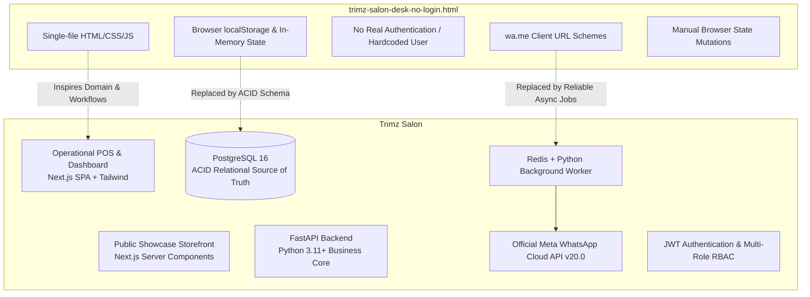
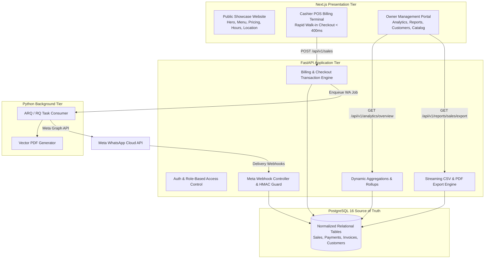

# Reference Feature Inventory & Prototype Reconciliation — Trimz Salon

| Document Metadata | Details |
| :--- | :--- |
| **Document Purpose** | Comprehensive analysis of the reference prototype (`trimz-salon-desk-no-login.html`) and reconciliation with production requirements |
| **Document Version** | 1.0.0 (Master Product Discovery Reference) |
| **Status** | Approved Architectural Inventory |
| **Author** | Antigravity Full Agency Team (Product, Architecture, Design, Engineering) |

---

## 1. Executive Context & Purpose of the Reference HTML

The reference prototype file ([trimz-salon-desk-no-login.html](file:///c:/Users/sai%20pallavi/OneDrive/Desktop/trimz/docs/trimz-salon-desk-no-login.html)) represents the **business domain, expected modules, terminology, and operational scope** of Trimz Salon as envisioned by the salon owner.

### Core Architectural Distinction: Prototype vs. Production

---

## 2. Exhaustive Feature Inventory & Phase Classification

The following matrix documents every feature demonstrated in the reference HTML, its underlying business objective, its production architectural requirement, and its strict phased classification (**MVP**, **Phase 2**, or **Future**):

| Feature / Screen | Present in HTML | Business Purpose | Phase Classification | Production Implementation Requirement |
| :--- | :---: | :--- | :---: | :--- |
| **Overview: Macro Metrics** | Yes | Daily sales, bills count, net sales, customer counts at a glance. | **MVP Core** | Derived dynamically from completed transactions via SQL aggregation in FastAPI. |
| **Overview: Revenue Chart** | Yes | Visual trend of weekly/monthly service vs product collections. | **MVP Core** | Aggregated time-bucket query returning JSON for frontend charting. |
| **Overview: Top Services** | Yes | Identify highest revenue-generating treatments. | **MVP Core** | `SUM(sale_items.total_price) GROUP BY service_id` query. |
| **Overview: Recent Bills** | Yes | Quick access to today's transaction log and reprint actions. | **MVP Core** | Paginated query on `sales` and `invoices` for today's local date. |
| **POS: Service Selection Grid** | Yes | Quick service lookup with Category & Audience (Men/Women/All) filters. | **MVP Core** | Cached service catalog filtered by category and gender targeting. |
| **POS: Retail Product Upsell** | Yes | Sell take-home shampoos, waxes, and hair products alongside services. | **Phase 2** (Post-MVP) | Retail line items require inventory stock reservation and separate accounting. |
| **POS: Mobile Customer Lookup** | Yes | Instant identification of returning guests, visit counts, and lifetime spend. | **MVP Core** | Indexed B-Tree search on normalized E.164 phone string in PostgreSQL. |
| **POS: Stylist / Staff Assignment** | Yes | Associate service line items with performing stylist for commission tracking. | **Phase 2** (Post-MVP) | Requires stylist ID on `sale_items` and commission calculation service. |
| **POS: Cart Math & Discount** | Yes | Automatic subtotal, manual/membership discount, and GST toggle (With/Without). | **MVP Core** | Pydantic validation and deterministic arithmetic engine in FastAPI. |
| **POS: Split & Digital Payments** | Yes | Support Cash, UPI (GPay/PhonePe/Paytm), Card, and split payments. | **MVP Core** | Normalized `payments` records with decoupled `payment_method` and `payment_provider`. |
| **POS: Printable Thermal Receipt** | Yes | 80mm thermal receipt formatted for direct printing at reception desk. | **MVP Core** | Responsive print stylesheet and clean vector HTML/PDF receipt template. |
| **POS: WhatsApp Invoice Delivery** | Yes | Share itemized receipt directly to customer's mobile. | **MVP Core** | Asynchronous Python worker dispatches official Meta WhatsApp Cloud API template. |
| **POS: Bill Editing & Modification** | Yes | Cashier editing of saved bills with retroactive ledger updates. | **MVP Core (Controlled)** | Regulated via `audit_logs`; cashier voids/refunds require Owner administrative PIN. |
| **Customer: 360° Profile View** | Yes | View customer visit count, lifetime spend, points, and preferences. | **MVP Core** | Fast aggregate profile view backed by transactional query and read-cache. |
| **Customer: WhatsApp Opt-In Toggle** | Yes | Explicit consent tracking for marketing greetings (`marketingOptIn`). | **MVP Core** | Boolean flag on `customers` table to ensure strict compliance. |
| **WhatsApp: Festival Greetings** | Yes | Pre-composed holiday greetings (Diwali, Eid, Pongal, New Year) for opted-in guests. | **Phase 2** (Post-MVP) | Background campaign dispatcher sending approved Meta utility/marketing templates. |
| **Appointments: Daily Scheduling** | Yes | Calendar queue tracking stylist allocation, time slots, and visit statuses. | **Phase 2** (Post-MVP) | Dedicated appointment booking model with calendar conflict locking. |
| **Services: Catalog Governance** | Yes | Organize services by category, audience, duration, and price. | **MVP Core** | CRUD endpoints with permanent historical price snapshots upon checkout. |
| **Staff: Targets & Commissions** | Yes | Monitor stylist performance, sales contribution, and incentive targets. | **Phase 2** (Post-MVP) | Commission calculation engine running against line items. |
| **Inventory: Stock Management** | Yes | Track stock levels, low-stock warnings (≤ 5 units), purchase costs, and expiries. | **Phase 3** (Post-MVP) | Consumables ledger with automatic stock depletion upon service completion. |
| **Memberships: Plans & Benefits** | Yes | Discount plans (e.g. TRIMZ Gold 15%) tied to customer phone numbers. | **Phase 3** (Post-MVP) | Membership entity with automated expiration dates and discount validation. |
| **Packages: Bundled Service Usage** | Yes | Multi-session packages with tracking of remaining sessions (e.g. 3 of 5 used). | **Phase 3** (Post-MVP) | Package redemption ledger tracking remaining service entitlements. |
| **Expenses: Daily Cost Outgoings** | Yes | Log petty cash, laundry, and operational expenses for net profit clarity. | **Phase 2** (Post-MVP) | Expense recording table integrated into daily register reconciliation. |
| **Reports: Sales & Payment Ledgers** | Yes | Filter sales by day/week/month; breakdown collection by payment method. | **MVP Core** | Dynamic SQL analytics matching dashboard totals exactly. |
| **Reports: CSV & PDF Data Export** | Yes | Download itemized sales spreadsheets and executive summary reports. | **MVP Core** | Memory-efficient streaming CSV generator and styled vector PDF generator. |
| **Loyalty: Spend-to-Points Engine** | Yes | ₹100 spent = 1 point; point balance tracking and redemption. | **Phase 3** (Post-MVP) | Loyalty ledger table with point earning and redemption audit trails. |
| **Feedback: Rating & Reviews** | Yes | Record 1–5 star ratings and stylist-specific feedback notes. | **Phase 2** (Post-MVP) | Post-visit customer feedback collection module. |
| **Daily Closing: Cash Reconciliation** | Yes | Reconcile opening cash, cash sales, UPI, card, and counted drawer cash. | **Phase 2** (Post-MVP) | End-of-day register closure record locking daily financial figures. |
| **Settings: Salon Profile & GST** | Yes | Configurable salon name, contact, GSTIN, bill prefix, and default tax rate. | **MVP Core** | `businesses` table with configurable tax and operational settings. |
| **Settings: Role-Based Access (RBAC)**| Yes | Distinct permissions for Owner/Admin, Manager, Receptionist, and Staff. | **MVP Core** | FastAPI dependency injection enforcing role guards on all routes. |
| **Settings: Audit Trail** | Yes | Chronological log of price overrides, bill cancellations, and discounts. | **MVP Core** | Immutable `audit_logs` table capturing user ID, timestamp, and payload snapshots. |
| **Settings: Backup & Restore** | Yes | JSON file export/import of client database records. | *Prototype Only* | Replaced in production by automated PostgreSQL WAL backups and pg_dump snapshots. |

---

## 3. Critical Prototype Behaviors to Overhaul in Production

1. **Storage Mechanism:**
   - *Prototype:* Uses browser `localStorage` (`data = JSON.parse(localStorage.getItem('trimzDesk'))`). Data is lost if browser cache is cleared or if opened on a different tablet.
   - *Production:* Every mutation is committed to **PostgreSQL 16** via FastAPI REST endpoints with ACID transactional guarantees.
2. **WhatsApp Integration:**
   - *Prototype:* Generates `https://wa.me/{phone}?text={encoded}` URLs that open the operator's personal WhatsApp desktop/web client and require manual sending.
   - *Production:* Dispatches asynchronous background jobs via **Redis + Python Worker** calling the **official Meta WhatsApp Cloud API (Graph API v20.0)** with structured utility templates and delivery webhooks (`SENT`, `DELIVERED`, `READ`).
3. **Authentication & Multi-User Access:**
   - *Prototype:* Hardcoded to a single user ("Harshith, Owner") with no login barrier.
   - *Production:* Secure **JWT Bearer authentication** with distinct roles (`OWNER` vs `OPERATOR`), password hashing (Argon2/bcrypt), and backend permission guards.
4. **Historical Price Snapshotting:**
   - *Prototype:* Contains basic item snapshots, but editing bills recalculates totals dynamically in memory.
   - *Production:* Immutable `sale_items` preserve `service_name_snapshot`, `unit_price_snapshot`, `discount_amount`, and `tax_amount` permanently.
5. **Separation of Concerns:**
   - *Prototype:* Conflates public discovery, booking forms, and internal POS into a single browser script.
   - *Production:* Cleanly splits the **Public Storefront** (Next.js server-rendered showcase for clients) from the **Internal Operations Dashboard** (authenticated Next.js + Tailwind POS and managerial dashboard).

---

## 4. Reconciled Architectural Mapping

---
*End of Reference Feature Inventory & Prototype Reconciliation.*
